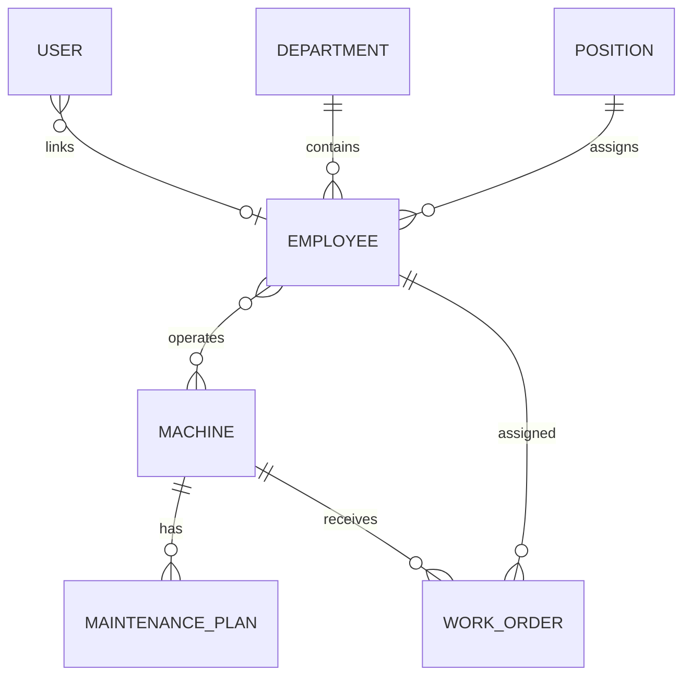

# Node.js API design

Express was chosen over NestJS because the requested feature-layered architecture is
explicitly represented as routes -> controllers -> services -> repositories, without
requiring a second dependency-injection framework.

## Folder structure

```text
src/
  app.ts
  server.ts
  config/                 # environment and Prisma client
  common/                 # errors, async handlers, pagination
  middlewares/            # authentication, authorization, validation, errors
  modules/
    auth/                 # routes, controllers, schemas, service
    employee/
    organization/
    machine/
    maintenance/           # plans + work orders
    ...
prisma/
  schema.prisma
  seed.ts
```

## ER diagram (initial migration increment)


